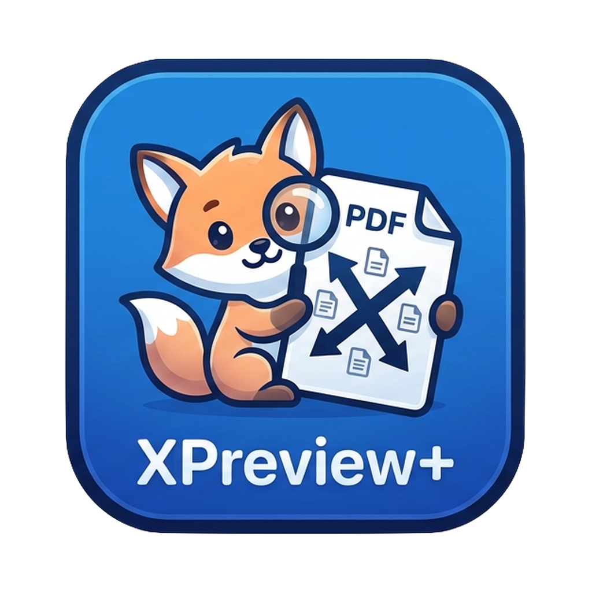
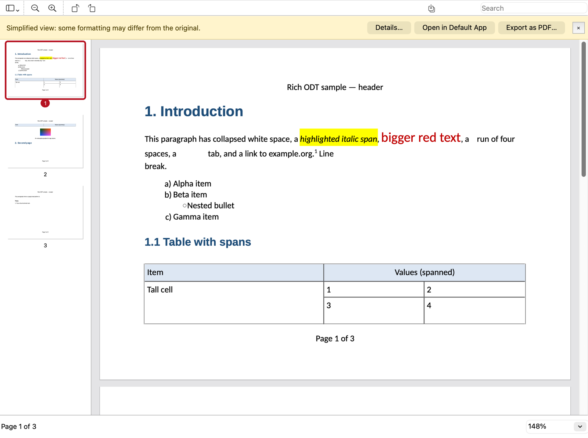

<p align="center">
  
</p>

<h1 align="center">XPreview+</h1>

<p align="center">
  A fast, cross-platform PDF, image and document viewer.<br>
  PDF · images · RTF · OpenDocument Text, with export of anything to PDF.
</p>

<p align="center">
  <a href="https://github.com/swijeyes/XPreview-Plus/releases/latest"></a>
  <a href="LICENSE"></a>
  
  
</p>

<p align="center"></p>

## Features

- **Opens:**
  - **PDF** (via PDFium), including password-protected files
  - **PNG, JPEG, GIF, WebP, TIFF** (multi-page), **BMP, HEIC** and **SVG**
  - **RTF**
  - **ODT / OTT / FODT** (OpenDocument text)

  Formats are detected from file content, not the extension.
- **Sidebar:** page **thumbnails**, or a **table of contents** (PDF bookmarks, or
  the headings of an RTF/ODT document).
- **Export as PDF** works for every format:
  - PDFs are copied byte-for-byte, or re-saved losslessly if rotated.
  - Everything else becomes real vector pages with selectable, searchable text.
- **Viewing:** continuous scrolling with fast tiled rendering; zoom, pinch-zoom,
  fit width and fit page; rotation.
- **Text:** search with highlights, text selection and copy, clickable links,
  printing.
- **Opening files:** tabs, recent files, drag-and-drop onto the window or the
  Dock icon, Open With in Finder.
- **Its own RTF and ODT renderer**, with no LibreOffice dependency. It handles:
  - fonts, with metric-compatible substitutes such as Calibri → Carlito
  - colours, highlights and lists
  - tables with merged cells, borders and shading
  - images, headers and footers with "Page X of Y", footnotes and heading numbering

  Anything simplified is reported in a "Simplified view" bar and in the
  Inspector (⌘I / Ctrl+I).
- **Security-hardened:** every file is treated as hostile. See [Security](#security).

## Documentation

The **[user manual](manual/xpreview-plus-manual.pdf)** (PDF, built from
[`manual/xpreview-plus-manual.tex`](manual/xpreview-plus-manual.tex) with
`tectonic`) covers installation, every feature, keyboard shortcuts, settings and
troubleshooting. It is also included in the release downloads.

## Download

Get the latest build from **[Releases](https://github.com/swijeyes/XPreview-Plus/releases/latest)**:

| Platform | File | Notes |
|---|---|---|
| macOS (Apple silicon) | `XPreviewPlus-<version>-macos-arm64.dmg` | Open the DMG and drag **XPreview+** to Applications. Builds that aren't notarised need right-click → **Open** the first time. |
| Windows 10/11 (x64) | `XPreviewPlus-<version>-windows-x64-portable.zip` | Unzip anywhere and run `XPreview+.exe`. Portable: no installer, no registry entries, and settings are kept in `settings\` next to the exe. |

Each file has a `.sha256` checksum next to it.

### Keyboard shortcuts

| Action | macOS | Windows / Linux |
|---|---|---|
| Open | ⌘O | Ctrl+O |
| Export as PDF | ⇧⌘E | Ctrl+Shift+E |
| Find / next / previous | ⌘F / ⌘G / ⇧⌘G | Ctrl+F / F3 / Shift+F3 |
| Hide sidebar / Thumbnails / Table of contents | ⌥⌘1 / ⌥⌘2 / ⌥⌘3 | Ctrl+Alt+1 / 2 / 3 |
| Actual size / Zoom in / Zoom out / Fit page / Fit width | ⌘0 / ⌘+ / ⌘− / ⌘9 / ⌘8 | Ctrl+0 / + / − / 9 / 8 |
| Rotate left / right | ⌘L / ⌘R | Ctrl+L / Ctrl+R |
| Inspector | ⌘I | Ctrl+I |

## Building from source

Requirements: CMake 3.21+, Ninja, a C++20 compiler and Qt 6.5+ (Core, Gui,
Widgets, Svg, PrintSupport, Concurrent; qtimageformats recommended).

### macOS

```sh
brew install qtbase qtsvg qtimageformats miniz ninja cmake
scripts/fetch-deps.sh            # PDFium binaries + bundled fonts
cmake -S . -B build -G Ninja -DCMAKE_PREFIX_PATH=$(brew --prefix)
cmake --build build
open build/XPreview+.app
```

Release DMG (bundles Qt, signs with the hardened runtime, runs the tests and a
launch check):

```sh
scripts/package-mac.sh                                    # ad-hoc signed → release/
SIGN_ID="Developer ID Application: …" scripts/package-mac.sh   # for distribution, then notarise
```

The macOS build uses Homebrew's Qt, so it runs on the macOS version it was built
on and newer. Build against the official Qt installer to support older systems.

### Windows (cross-compiled from macOS or Linux)

```sh
brew install qtbase ninja cmake sevenzip   # host Qt tools must match the Windows Qt version
scripts/package-windows.sh              # → release/XPreviewPlus-<version>-windows-x64-portable.zip
```

`scripts/fetch-windows-deps.sh` downloads llvm-mingw and Qt for Windows
(checksum-verified), plus PDFium and miniz. The packaging script checks that
every DLL the binaries import is either bundled or part of Windows. Building
natively on Windows with MSVC and the standard CMake flow also works.

### Linux

The code and CMake are portable, but Linux builds haven't been tested yet.

```sh
sudo apt install qt6-base-dev qt6-svg-dev qt6-image-formats-plugins ninja-build cmake
scripts/fetch-deps.sh
cmake -S . -B build -G Ninja && cmake --build build
```

### Tests and tools

```sh
ctest --test-dir build                         # unit, security and UI layout regression tests
build/xpreview-render FILE --out DIR --pdf OUT.pdf --search TEXT   # headless render/export
cmake -S . -B build-asan -DXPREVIEW_SANITIZE=ON   # AddressSanitizer + UBSan build
```

## Security

XPreview+ opens files from untrusted sources, so every parser is written to fail
safely. All limits live in [`src/core/Limits.h`](src/core/Limits.h).

- **No unbounded recursion:** the RTF tokenizer, the XML readers, ODF tables
  and nested tables all have depth caps, and worker threads get large stacks.
- **Resource caps:**
  - ZIP entry count, size and compression ratio; path-traversal entries are ignored.
  - Input file size, table cells and tab stops.
  - Embedded images: dimensions are checked before decoding, and there is a
    per-document decode budget.
  - Bitmap, thumbnail and print raster sizes.
- **Geometry from files is sanitised:** page sizes, margins, lengths, fonts and
  table edges are clamped and made finite.
- **No access outside the document:** SVG references to local files are
  stripped (including svgz and SVG embedded in ODT), and ODF images resolve
  only inside the package. Links open only on click, and only for http, https
  and mailto. Macros and scripts never run.
- **Export:** writes are atomic (`QSaveFile`), so a failed export never leaves
  a partial file, and exporting over the open source file is safe.
- **Build hardening:**
  - Stack protector everywhere.
  - Windows: ASLR, high-entropy VA and DEP.
  - Linux: PIE, full RELRO and FORTIFY.
  - macOS: hardened runtime.
- **Verification:** there are regression tests for each fixed issue, and a
  fuzz campaign of 1,800 mutated files under ASan and UBSan finished with zero
  findings.

Please report vulnerabilities privately through GitHub's **Security → Report a
vulnerability** on this repository.

## Project layout

```
src/core    document interface, format sniffing, loader, exporter, fonts, limits, safe images
src/pdf     PDFium backend
src/image   raster and SVG backends
src/flow    shared FlowModel, QTextDocument builder, paginated document
src/rtf     RTF tokenizer + interpreter
src/odf     ODF package reader, style resolver, ODT importer
src/ui      main window, tabs, page view, async tile renderer, thumbnails
tests       unit/security tests, headless render tool, sample corpus
scripts     dependency fetchers and macOS/Windows packaging
manual      user manual (LaTeX source, figures, PDF)
plan        the original design plan
```

## Roadmap

These are planned and not built yet:
- **Spreadsheets and presentations:** ODS and ODP. Both are detected today and
  reported as unsupported.
- **Pictures and animation:** animated GIF/WebP playback, and WMF/EMF pictures
  in RTF (currently placeholders).
- **Text layout:** footnotes placed on their own page, and text selection that
  continues across pages.
- **PDF editing:** annotations and form filling.
- **Packaging:** App Sandbox, a sandboxed parser process, and a Linux AppImage
  or Flatpak.

## Contributing

Issues and pull requests are welcome. Please run `ctest` before submitting.
For parser changes, also add a test to `tests/tst_importers.cpp`. By
contributing you agree that your contributions are licensed under the
AGPL-3.0-or-later.

## License

Copyright © 2026 Sanjeeva Wijeyesakere

XPreview+ is free software: you can redistribute it and/or modify it under the
terms of the **GNU Affero General Public License** as published by the Free
Software Foundation, either version 3 of the License, or (at your option) any
later version. See [`LICENSE`](LICENSE).

It is distributed in the hope that it will be useful, but **without any
warranty**.

XPreview+ includes third-party components: Qt (LGPL-3.0), PDFium
(BSD-3-Clause/Apache-2.0), miniz (MIT), the Arimo, Tinos and Cousine fonts
(Apache-2.0), and the Carlito and Caladea fonts (SIL OFL 1.1). All are compatible with the AGPL; see
[`THIRD_PARTY_NOTICES.md`](THIRD_PARTY_NOTICES.md), with full license texts in
[`licenses/`](licenses).
